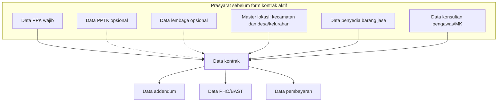
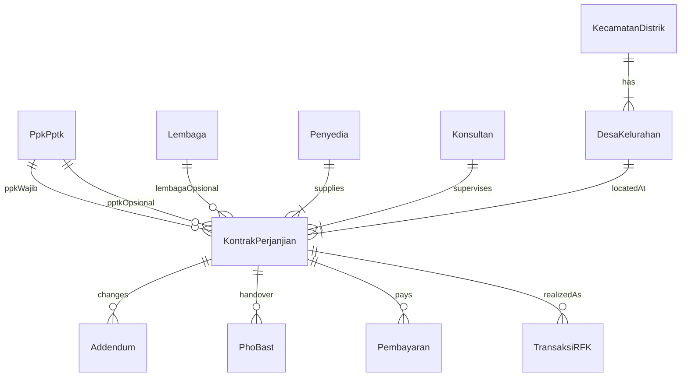

# SIREFIK — Alur dan Mekanisme Data Kontrak

Dokumen ini merinci penginputan **data kontrak** dan rinciannya. Implementasikan hanya yang tertulis di sini. Jangan menambah syarat produk di luar dokumen ini.

Menu terkait (kelompok **Data Kontrak**):

1. Data Kontrak
2. Data Penyedia Barang Jasa
3. Data Konsultan Pengawas/MK
4. Data Addendum
5. Data PHO/BAST
6. Data Pembayaran

Hub rincian kontrak adalah tabel `kontrak_perjanjian`, bukan `transaksi_rfk`. Transaksi RFK tetap merujuk kontrak, tetapi addendum, PHO/BAST, dan pembayaran melekat pada kontrak.

---

## Alur

Urutan kerja yang diharapkan:

1. Lengkapi data induk yang **wajib** untuk kontrak (PPK, lokasi kecamatan + desa/kelurahan, penyedia, konsultan pengawas/MK).
2. PPTK dan lembaga boleh kosong; tidak menghalangi pembukaan form kontrak.
3. Input **data kontrak**.
4. Setelah kontrak tersimpan, input rincian: addendum, PHO/BAST, dan pembayaran.

---

## Gerbang input data kontrak

Form **Data Kontrak** tidak dapat diisi (tombol/tautan tambah dinonaktifkan, POST ditolak) apabila salah satu data **wajib** berikut masih kosong:

| Data | Sifat | Efek jika kosong |
| --- | --- | --- |
| PPK | Wajib | Kontrak tidak dapat diisi |
| PPTK | Opsional | Kontrak tetap dapat diisi; kolom PPTK boleh kosong |
| Lembaga penerima hibah | Opsional | Kontrak tetap dapat diisi; kolom lembaga boleh kosong |
| Lokasi: kecamatan/distrik **dan** desa/kelurahan | Wajib (master wilayah) | Kontrak tidak dapat diisi |
| Penyedia barang jasa | Wajib | Kontrak tidak dapat diisi |
| Konsultan pengawas/MK | Wajib | Kontrak tidak dapat diisi |

“Masih kosong” berarti tidak ada baris aktif (`is_deleted` = tidak terhapus) pada master terkait. Untuk lokasi, master `kecamatan_distrik` dan `desa_kelurahan` harus berisi data (wilayah berjenjang dari kabupaten/kota yang dipilih).

Pesan UI (Bahasa Indonesia), contoh: *Data kontrak belum dapat diisi. Lengkapi PPK, lokasi kecamatan dan desa/kelurahan, penyedia barang jasa, serta konsultan pengawas/MK terlebih dahulu.*

Pada baris kontrak yang disimpan:

- `kontrak_ppk` wajib.
- `kontrak_pptk` boleh `NULL`.
- `kontrak_lembaga` boleh `NULL`.
- `kontrak_penyedia` wajib.
- `kontrak_pengawas` wajib (konsultan pengawas atau MK).
- Lokasi pekerjaan wajib sampai desa/kelurahan; kecamatan dipilih di form untuk memfilter desa, lalu desa disimpan pada kontrak.

---

## 1. Data kontrak

Satu baris `kontrak_perjanjian` = satu paket pekerjaan yang sudah memiliki kontrak/SPK.

### Mekanisme

- Hanya staf (dan peran yang sudah diizinkan menginput kontrak) yang menambah/mengubah kontrak.
- Form baru hanya tampil jika gerbang di atas terpenuhi.
- PPK, penyedia, dan konsultan dipilih dari dropdown master (bukan ketik bebas).
- PPTK dan lembaga tampil sebagai dropdown opsional (opsi kosong diizinkan).
- Lokasi berjenjang: provinsi → kabupaten/kota → **kecamatan/distrik** → **desa/kelurahan**. Kecamatan dan desa wajib dipilih. Kecamatan tidak perlu disimpan sebagai kolom terpisah jika desa sudah merujuk kecamatan; yang tersimpan pada kontrak tetap set lokasi yang ada (`kontrak_provinsi_id`, `kontrak_kab_kota_id`, `kontrak_desa_kelurahan_id`).
- Nilai uang ditampilkan `Rp` dengan pemisah ribuan titik, dua desimal koma, rata kanan.

### Isian utama

- Nomor kontrak/SPK
- Nama paket
- Tanggal kontrak, tanggal mulai, tanggal selesai, jangka waktu (hari)
- HPS, nilai kontrak
- Jenis kontrak
- PPK (wajib), PPTK (opsional)
- Lembaga (opsional)
- Penyedia (wajib)
- Konsultan pengawas/MK (wajib)
- Provinsi, kabupaten/kota, kecamatan, desa/kelurahan
- Keterangan

Rincian addendum, PHO/BAST, dan pembayaran **bukan** bagian form create kontrak; diisi setelah kontrak ada, lewat menu masing-masing (atau dari halaman detail kontrak yang sama).

---

## 2. Data penyedia barang jasa

Master pihak rekanan. Tabel `penyedia`.

### Mekanisme

- Diisi **sebelum** data kontrak.
- Minimal satu penyedia aktif agar gerbang kontrak terbuka.
- Kontrak merujuk `kontrak_penyedia` → `penyedia.id`.

### Isian

- Nama (wajib)
- NPWP (opsional)
- Alamat (opsional)

Soft-delete: baris yang dihapus tidak muncul di dropdown kontrak.

---

## 3. Data konsultan pengawas/MK

Master konsultan. Tabel `konsultan`.

### Mekanisme

- Diisi **sebelum** data kontrak.
- Minimal satu konsultan aktif (jenis pengawas atau MK) agar gerbang kontrak terbuka.
- Kontrak merujuk `kontrak_pengawas` → `konsultan.id`.

### Isian

- Nama konsultan (wajib)
- Jenis: `pengawas` atau `mk` (Manajemen Konstruksi)

---

## 4. Data addendum

Perubahan kontrak (nilai dan/atau waktu). Tabel `addendum`.

### Mekanisme

- Hanya dapat diisi jika **data kontrak** sudah ada.
- FK: `addendum.kontrak_id` → `kontrak_perjanjian.id`.
- Urutan addendum mengikuti waktu input / `addendum_ke`.
- **Nilai berlaku** paket = `nilai_baru` addendum terakhir; jika belum ada addendum, = `kontrak_nilai`.
- Pembayaran tidak boleh melebihi nilai berlaku.

### Isian

- Nomor addendum
- Tanggal addendum
- Addendum ke (opsional)
- Tanggal selesai baru (opsional)
- Nilai baru
- Uraian

---

## 5. Data PHO/BAST

Berita acara serah terima. Tabel `pho_bast`.

### Mekanisme

- Hanya dapat diisi jika **data kontrak** sudah ada.
- FK: `pho_bast.kontrak_id` → `kontrak_perjanjian.id`.
- Satu kontrak boleh punya PHO dan/atau BAST (jenis terpisah).

### Isian

- Jenis: `PHO` atau `BAST`
- Tanggal
- Nomor

---

## 6. Data pembayaran

Termin pembayaran atas kontrak. Tabel `pembayaran`.

### Perubahan FK (wajib)

Saat ini kolom `pembayaran.transaksi_id` merujuk `transaksi_rfk.id` (`fk_pembayaran_transaksi`).

Ubah menjadi merujuk **kontrak**:

- Ganti kolom `transaksi_id` menjadi `kontrak_id`.
- FK baru: `pembayaran.kontrak_id` → `kontrak_perjanjian.id`.
- Hapus `fk_pembayaran_transaksi`.
- Migrasi data lama (jika ada): `kontrak_id` = `transaksi_rfk.kontrak_id` dari baris yang sebelumnya ditunjuk `transaksi_id`.

### Mekanisme

- Hanya dapat diisi jika **data kontrak** sudah ada.
- Pilih kontrak (bukan transaksi RFK).
- Jumlah seluruh termin pada kontrak itu tidak boleh melebihi **nilai berlaku** (kontrak atau addendum terakhir).
- Cache realisasi keuangan pada `transaksi_rfk` (jika transaksi RFK untuk kontrak itu sudah ada) tetap dihitung dari jumlah pembayaran kontrak yang sama.

### Isian

- Kontrak (wajib)
- Termin (angka)
- Tanggal
- Nilai
- Uraian (opsional)

---

## Relasi

PPK wajib, PPTK opsional: keduanya merujuk data PPK/PPTK (atau pengguna OPD yang menjabat PPK/PPTK), sesuai master yang dipakai aplikasi. Lembaga tidak wajib.

---

## Lingkup terbuka

Dokumen ini tidak mencakup verval, STS/denda, prestasi fisik, atau laporan. Hal itu tetap mengikuti [issue.md](issue.md). Apa yang tidak tertulis di sini boleh ditambah nanti; jangan mengarang syarat tambahan hanya untuk “melengkapi” spesifikasi ini.
